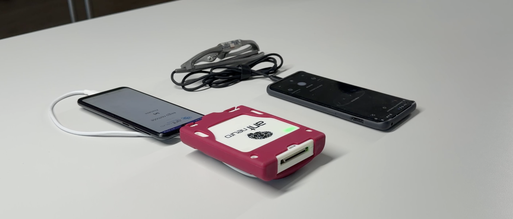
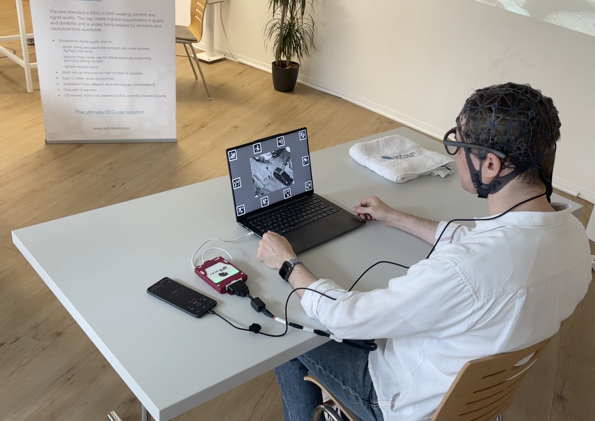
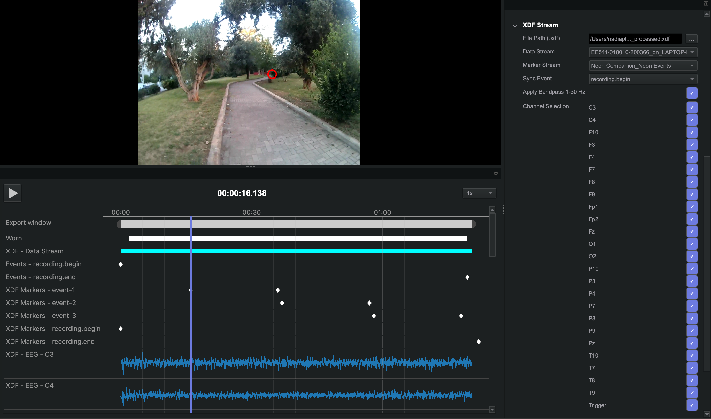

<Youtube src="mMOvOm2Nhro"/>

:::tip
Put neural activity back into context: fuse wearable eye tracking with mobile EEG to inspect brain activity frame-by-frame against the participant's actual point of view.
:::

What changes when a participant can leave the lab without leaving the experiment behind? Combining eye tracking and EEG lets you examine where someone looks alongside their brain activity, whether they are completing a screen-based task or moving through a real-world environment.

In this Alpha Lab guide, you'll see how to record Neon gaze and ANT Neuro eego™ EEG together with Lab Streaming Layer (LSL) and LabRecorder. You'll then see how we brought the EEG into Neon Player, using a custom plugin to review it alongside the participant's scene video, gaze, and events. The same workflow can be adapted to studies in the lab or on the move.

## The Equipment

The setup combined [Neon glasses](https://pupil-labs.com/products/neon) and their Companion Device with an [ANT Neuro waveguard net](https://www.ant-neuro.com/products/waveguard-net), [eego24™ amplifier](https://www.ant-neuro.com/products/eego-24), and a commercially available smartphone with the eego remote app installed.

***Equipment.** Neon glasses and Companion Device beside the ANT Neuro eego24, waveguard net and smartphone with eego remote app installed.*{.image-caption}

In the lab, the participant wore both systems while working at a laptop. The same wearable combination allowed us to continue recording as the participant moved outdoors.

***Indoor task.** Participant wearing Neon and the ANT Neuro waveguard net during the lab task.*{.image-caption}

## Record Both Streams With LSL

Neon publishes gaze data through its built-in LSL output. The eego™ system can also publish EEG through LSL. We collected the streams using LabRecorder, which saved the data and timing information in an XDF file.

The recording workflow was:

1. Enable "Stream over LSL" in the Neon Companion App.
2. Enable EEG streaming over LSL in the eego software.
3. Check that the devices and LabRecorder can discover one another on the local network.
4. Select the Neon and EEG streams in LabRecorder, then start the XDF recording.
5. Simultaneously launch a recording on the Neon Companion Device. This preserves the scene video alongside Neon's raw data. Crucially, events sent to Neon (including the default `recording.begin` and `recording.end` events) stream directly to LabRecorder, allowing you to align raw Neon data with the XDF file later using the XDF Stream Plugin in Neon Player.

Neon's LSL streams are named `[Device Name]_Neon Gaze` and `[Device Name]_Neon Events`. See the [Neon LSL documentation](https://docs.pupil-labs.com/neon/data-collection/lab-streaming-layer/) for stream contents and connection guidance. ANT Neuro describes its EEG streaming settings in its [third-party integration guide](https://academy.ant-neuro.com/blog/application-notes-2/third-party-integrations-with-eegotm-systems-86).

This workflow produces two useful recordings: the native Neon recording, including scene video, and the XDF file containing the streams selected in LabRecorder.

## Load The Data in Neon Player

To inspect the recorded data, we opened the native Neon recording in [Neon Player](https://docs.pupil-labs.com/neon/neon-player/) and loaded the XDF file using our **XDF Stream plugin** (available in version 6.1.0 and later). The plugin allows you to select EEG channels and plot their traces directly alongside the scene video, gaze overlay, and shared events, all unified on a single timeline.

For this demo, we used the Neon event stream and a shared synchronization event to align the XDF data with the Neon recording. In the outdoor example, the EEG channels appear below the video, so we can move through the recording and inspect brain activity alongside what the participant saw.

***Neon Player XDF Stream Plugin.** Neon Player showing outdoor scene video, gaze overlay, events, and EEG channels from the XDF file.*{.image-caption}

## From a Screen-Based Task To An Outdoor Walk

The lab segment shows the participant using a laptop while wearing both systems. The outdoor segment takes the same combination into a setting where the participant can move through the environment. These examples show why it helps to keep gaze, EEG, events, and first-person video available for review together.

Moving outdoors adds practical checks. The LSL devices and recorder need a working local network, and the EEG signal should be checked during movement. For studies that depend on precise stimulus timing, validate the delay between the physical event and its recorded marker in the actual setup. LSL stores clock-offset information for aligning streams after recording, but timing performance depends on the complete recording system.

## Try It With Your Research

The [Neon LSL guide](https://docs.pupil-labs.com/neon/data-collection/lab-streaming-layer/) is the starting point for configuring Neon's streams. If you'd like help to develop a fully worked multimodal experiment with a task script, event markers, and XDF analysis, we'd be happy to help you get started. 

:::tip
You can reach out to us directly at [info@pupil-labs.com](mailto:info@pupil-labs.com), join the conversation on our [Discord server](https://pupil-labs.com/chat/), or visit our [Support Page](https://pupil-labs.com/products/support/) for more formal support options and documentation.
:::