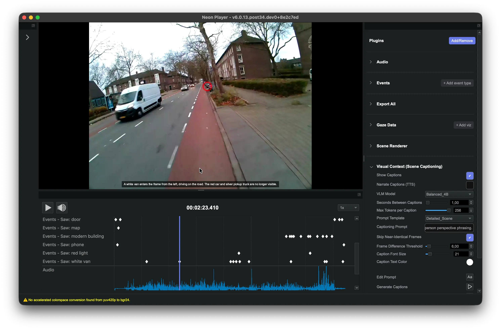

# Scene Captioning

<TagLinks :tags="$frontmatter.tags" />

<Youtube src="Y2Gu2_6TM7w"/>

::: tip
Turn scene video into searchable context, locally. Visual Context automatically describes what is visible in a Neon recording, creating timestamped captions that can be reviewed, exported, or turned into events. Everything runs on your own machine, with no cloud processing, API key, or video upload.
:::

## Search Your Recordings by What Happened

Eye-tracking recordings contain more than gaze data. The scene camera captures the environment around every fixation: objects, people, activities, places, screens, and countless other pieces of context.

But that context is difficult to work with at scale. Finding every moment where someone was holding a product, looking at a laptop, standing in front of a shelf, or interacting with a particular object can mean manually reviewing large amounts of video.

What if Neon Player could describe the scene for you? The **Visual Context Plugin** explores that idea by running a vision-language model (VLM) directly on the scene-camera footage. It samples moments throughout a recording and generates short descriptions of what it sees.

The result is a new textual layer over the recording: one that can help researchers navigate video, search for moments of interest, and turn visual context into events for further exploration.

And because the model runs locally, the scene video stays on your machine.

## How it Works

Vision-language models take images as input and can respond to natural-language instructions about what they contain. That instruction can be broad, such as *“Describe what is happening in this scene,”* but it can also be narrowed to suit a particular experiment: *“Name only the object the wearer is holding.”*

Visual Context applies the same prompt across sampled moments in the recording. Over time, this creates a timestamped sequence of descriptions that acts as a rough semantic index of the scene video.

This becomes interesting when you know **what** you are looking for, but not **when** it happened. Instead of scrubbing through a long recording to find every appearance of a laptop, for example, you can use the generated descriptions to identify likely moments first and then return to the video to inspect them.

## The Plugin

We built a [Neon Player plugin](https://github.com/pupil-labs/npp-visual-context) to experiment with this workflow locally. It uses Qwen3-VL and offers three model sizes: **Fast (2B)**, **Balanced (4B)**, and **Quality (8B)**. On Apple Silicon, quantized versions run locally using MLX, while other systems can use a transformers backend with a suitable CUDA GPU.

Once generated, the captions appear over the scene video as you play the recording. You can also open the complete timestamped list or export it as CSV. The captioning prompt is editable too, so you can move from general scene descriptions toward something more specific to the question you are investigating.

One of the more useful things to try is turning those descriptions into **events**. Search for a word or phrase such as `laptop`, and Visual Context can add `Saw: laptop` events wherever the generated captions mention it. If the laptop remains visible across several consecutive captions, those matches are treated as one continuous occurrence rather than producing an event every few seconds.

The resulting events behave like other Neon Player events, which means the model’s descriptions can become a starting point for existing event-based workflows rather than remaining a separate set of AI-generated text.

## Steps to Recreate

1. Download the [Visual Context plugin](https://github.com/pupil-labs/npp-visual-context) from our Github.
2. [Install the plugin in Neon Player](https://docs.pupil-labs.com/neon/neon-player/plugin-api/#adding-a-plugin) and open a recording.
3. Choose a model and, if useful, adapt the captioning prompt to what you want the model to look for.
4. Generate captions and let the model work through the scene video locally.
5. Play back the recording and inspect the generated descriptions.
6. Search for a word or phrase relevant to your recording and try turning the matches into events.
7. Export the captions as CSV if you want to continue working with them elsewhere.

The first run also downloads the selected model, so it takes a little longer to get started. Captioning itself is not instant either: processing time depends on your hardware, model, recording length, and how frequently frames are sampled. Results are cached, though, so once a recording has been processed you do not need to generate the same captions every time you open it.

## What You'll Learn to Build

The **Visual Context Plugin** adds a locally generated textual layer to scene video. It produces timestamped descriptions that you can see during playback, browse as a list, search for words or phrases, turn into Neon Player events, or export as CSV.

You can keep the descriptions broad or change the prompt to focus the model on something relevant to your experiment. The sampling interval can also be adjusted depending on whether you want finer temporal coverage or faster processing, and visually similar frames can be skipped to avoid repeatedly describing a scene that has barely changed.

On Apple Silicon, `Fast (2B)` and Balanced `(4B)` are practical places to start. Larger models need more memory and take longer to process each frame, so there is a trade-off between model size and how quickly you can get through a recording.

Most importantly, these captions should not be treated as ground-truth annotations. Vision-language models can miss details, misidentify objects, or occasionally describe something that is not actually there. The useful role here is to help you **search, navigate, and explore** a recording. If a generated description becomes part of your analysis, check the corresponding moment against the original scene video.

::: tip
Want to adapt this experiment to your research or need help getting it running? Reach out to us via email at [info@pupil-labs.com](mailto:info@pupil-labs.com), on our [Discord server](https://pupil-labs.com/chat/), or visit our [Support Page](https://pupil-labs.com/products/support/) for dedicated support options.
:::
